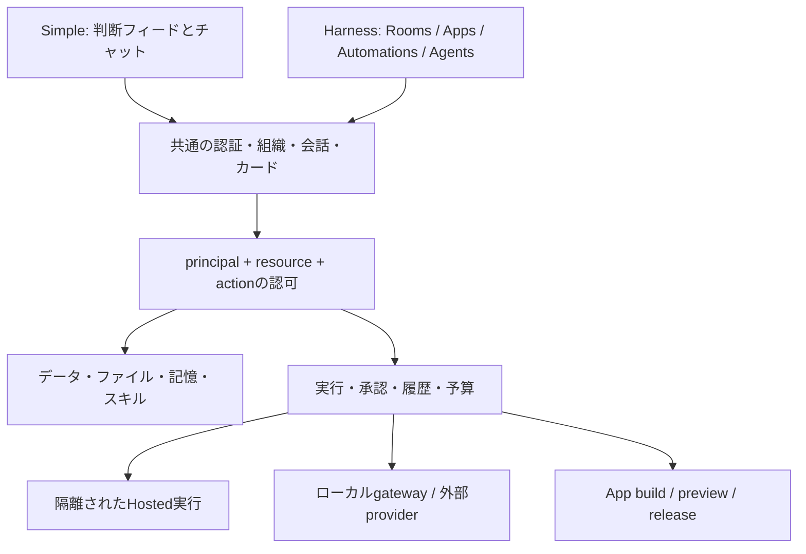

# Simpleを保つ拡張設計

## 不変条件

- 既存の判断カード・フィード・チャット・Routines・Playbookと既存クライアントを維持する。
- 新規・既存workspaceの既定はSimple。既存APIとschemaを破壊しない。
- modeは主に表示と新規作成時の初期設定を決める。保存済みのデータ保持・アクセス権・監査・ルームルールはmodeで無効にしない。
- Harnessのコードは追加モジュール・遅延ロード。SimpleにApp builder/gatewayの必須起動や課金を持ち込まない。
- 画面を隠すことと、自動化を停止することは別。Simpleに戻しても保存済み自動化は既存スケジュールで動く。停止は自動化の操作として明示する。

## 体験を二層に分ける

`org_settings.mode` はチームの既定表示。Web/Electronの `hx.simple.<base>.<org>` はそのブラウザだけのSimple優先設定。後者は非adminでも利用でき、共有modeのPUTを呼ばない。現在の設定はブラウザprofile単位で同じ端末の利用者に共通。ユーザーごとの端末間同期には別途authenticated preference APIを追加する。

効果的な表示は `browserSimple ? simple : workspaceMode`。workspace・sessionが変わると古いmodeとcanEditを破棄し、応答前はSimple。機能の権限チェックは常にサーバーで行う。

## 分離する責務

| 境界 | 実装方向 |
|---|---|
| Identity/Policy | 人・agent・app・workflowをprincipalとして扱い、依頼者と代理実行者を別々に検証。workspace adminのprivate room bypassは禁止 |
| Resources | 所有room、追加参照、共有grantを分離。リンクは権限付与ではない。既存Appの共有範囲を勝手に縮小せず移行プレビューを作る |
| Runs | durable run、revision、step、effect receipt、lease、cancel token。決定カードはapprovalの一つのUI |
| Memory | structured entryとsource room/person、共有knowledge、TTL/review。現在の記憶は互換readerで読み、適用先不明を全社共有に変換しない |
| App runtime | 既存typed tablesを互換adapterで使い続ける。Database Appのcontract、次にCustom Appのisolated build/preview DB/hostを追加 |
| Integrations | secret vaultと許可host、接続owner、agent/app grant。検索カタログと実行権を分離 |
| Metering | 事前予約→実行→精算。既存Simple個人プランとHarness workspace creditsを分離して移行 |
| Clients | Web/Electron先行、SwiftUI/Expoは既存APIに追加対応。全端末の機能表を持ち、Web実装だけで全対応としない |

## 実装順と依存関係

### A. データ・認可・Simple回帰

今回のmode/grant/guidelines修正を基点に、App/Table/Workflow/Follow-upのroom ACLを統一する。新しい `resource_grants`、`agent_memberships`、`resource_threads` を追加し、既存の公開範囲を明示する移行を設計する。旧clientでSimpleが動くことをリリース条件にする。

### B. 会話・記憶・実行

固定thread、single leader/handoff、run cancel、structured memoryを実装。外部作用のretry/idempotencyとimmutable workflow revisionを先に整える。既存workflowが承認待ちの間に編集された場合も開始時の定義を使う。

### C. Database Apps

entity/relation、calendar、保存ビュー、record discussion、OpenAPI contract、bulk import/export、App内automation。既存Tableは壊さず互換APIを維持する。移行前後の件数・型・ID・関連・会話リンクを検証してから切替。

### D. Custom Apps

隔離build、Git draft、preview DB fork、migration journal、commitに束縛した公開承認、hosting、rollback、domain、App connection proxy。実行基盤の選定と資格情報の接続が必要。ボタンだけ実装して公開済み扱いにしない。

### E. Gateway・スキル・接続

ローカルdaemon、device link、provider adapters、ACP、offline/reconnect、skill packages、接続catalog・OAuth・MCP・custom APIs。外部providerごとの契約・キー・試験accountが必要。既存契約の認証方式は公式条件を確認する。

### F. 予算・配布・同等性試験

workspace credits、budget policy、通知、各native client、音声/生成media。全93項目の受入証拠を揃え、差異と環境限定機能を明示した互換版としてリリース。その後に判断フィードを用いた比較実験へ進む。

## このブランチの運用

DB追加は `hx_room_guidelines`、`hx_memory_scopes`、`hx_workflow_run_definitions`、`hx_app_access`。schema/migrationは冪等なCREATE。既存データのDELETEや破壊的ALTERはない。新テーブルを適用後にWorkerを更新し、その後Webを配布する。旧Workerへ戻しても新テーブルは残してよい。新UIには新APIが必要。

未完了: Agent admin/memberの完全なモデル、旧記憶の出典復元・人単位の記憶共有、App等のACL、BYOへのguidelines、全AI入口、nativeの個別Simple設定。テスト合格はこれらの完了を意味しない。

## 2026-10-16の追加実装

新規チャット記憶には、元の会話キーとcontext/preference/feedback/referenceの型を別テーブルに保存する。既存記憶の自動移動は行わない。スコープ行がない旧記憶と明示共有知識は従来どおり共有されるため、旧記憶に私的内容がある場合のレビュー・移行は別途必要。会話を指定する新APIは会話認可を先に行う。保存済みDMキーは依頼者の表示用参照へ解決してから認可する。

run開始時に定義スナップショットを原子的に保存。再開時は保存定義を使うが、実行権限は現在の状態で再検証する。新テーブルが存在しない旧Workerへ戻すと旧動作に戻り、分離保証を失うため、この変更後のロールバック先にも認可修正が必要。

## Database Appの公開範囲

`hx_app_access` は後方互換のsidecar。行のない既存Appは従来のworkspace共有を保持し、所有者だけがprivate/workspaceをversion付きで変更できる。privateは現在のworkspace membershipを持つ所有者のみで、管理者の迂回はない。ルームリンク自体は権限を付与しない。

同じAppのtableへのHTTP/MCPアクセス、Home集計、Workflow定義・run履歴・実行時の書き込み・row triggerにもポリシーを適用。過去に別の場所へ送信済みのメッセージや承認カードの複製を遡って消す機能ではない。所有者移譲・明示的な個人/room grants・匿名公開・Custom App hostingは別の未完了項目。

## レコード契約の互換境界

`/tables/:id/contract` は現在のテーブル定義からOpenAPI 3.1を生成する。`validation: "strict"` を選ぶ書き込みだけに、同じ定義に基づく型・列ID・形式の検証を適用する。既存のSimple/agent/workflowクライアントの値変換を突然変更しない。契約は現時点のスナップショットで、スキーマ変更との競合や契約バージョンの固定は今後の課題。

行の更新・削除はDBで `updated_at` の一致を条件に実行する。新Webは読み取った `updatedAt` を `expectedUpdatedAt` として送り、MCPも同じ引数を受け付ける。時刻は更新ごとに最低1ms進めるため、同一ミリ秒の連続更新でもトークンを再利用しない。409の操作では後続ワークフローを発火しない。古いクライアントがトークンを送らない場合もサーバー内の読取/更新間の競合は検知するが、ユーザーが古い画面を見ていたかは判定できない。

## Harnessエージェントの初期公開範囲

標準作成・Markdown取込は、サーバーのworkspace modeがHarnessの場合にpersonal scopeで作成する。ブラウザのSimple優先設定は初期公開範囲を変更しない。profileを同一batchで保存し、profileのない旧エージェント向けルーム配置互換を新規エージェントへ適用しない。profileのaccessはscopeの制限に追加する条件であり、personal scopeの間はeveryoneでも作成者以外を許可しない。UIも実効的な公開範囲を表示する。

所有者は作成後の編集でteam scopeへ変更できる。既存レコードのscopeは移行しない。Simpleで作成する旧経路、Studioで外部providerを登録する経路は今回の変更対象外。独立したAgent Admin/Memberと所有者移譲は別の未完了項目。

## スキルの所有者と非公開本文

`hx_skill_access` のない既存スキルはworkspace共有を保持する。旧APIクライアントの省略値もworkspaceを保持し、新Webの作成フォームは明示的にprivateを指定する。作成とpolicyを同一batchで保存する。所有者だけがversion付きで共有範囲を変更でき、privateにはworkspace adminの迂回を設けない。公開済みスキルへの従来の管理者編集権は保持する。

private本文を呼出者へ渡すだけでは不十分なので、実行時も所有者のmembershipと直接agent会話キーを検証する。privateは所有者の直接会話とそのfollow-upだけへ注入する。共有ルーム・workflowログ・所有者不明の内部呼出へは注入しない。共有解除はリンクを残し、次回実行で現在のvisibilityを確認する。スキル一覧に載るagentリンクも閲覧者に見えるagentだけへ絞る。

このpolicyを無視する旧Workerへロールバックするとprivate本文を保護できない。ロールバック版にもskillAccessの読取制御を保持する。パッケージ資産、独立したagent grant、共有URLは別途実装する。

### Existing-contract execution nodes

The optional `gateways` Harness screen talks to an independent outbound-only node
protocol. `hx_gateways` stores hashed node credentials; `hx_gateway_jobs` stores
requester-owned jobs with idempotency keys and expiring leases. The local `gateway/`
runner fixes the image and VM restrictions independently of remote payloads.
Simple mode and its code/data remain untouched. This boundary allows a later fleet
implementation without embedding Mac-specific execution in Honmaru's control API.
See [Mac mini gateway](../mac-mini-gateway.md) for deployment and tenancy limitations.

### Saved view controls and personal navigation (2026-10-17)

`definition.views[].filters` stores up to 20 conjunctive rules (`eq`, `neq`, `contains`, `empty`, `not_empty`, `gt`, `lt`). Legacy `where` constraints remain active until explicitly cleared. Server-side `computeView` applies conditions consistently to tables, boards, calendars and metrics. Table/board `groupBy` uses actual values, including non-select columns; missing values have their own group. UI writes include `expectedVersion` and retain the draft when the server rejects a stale edit. Shared view editing is exposed to creators/admins, and changes remain versioned. This is not yet a personal-view or column-layout implementation.

`hx_app_pins` stores `(org_id,user_id,app_id)` in existing D1. Session identity determines the user; requests cannot supply another user's identity. Each PUT sets one app's desired state idempotently rather than replacing a whole list. GET filters current app access. Foreign keys clean up pins with an app or account deletion. Visible clients refresh on focus, visibility changes and every 30 seconds; changing auth/workspace clears the prior scope immediately. It is eventual synchronization, not a WebSocket broadcast. Legacy browser-only IDs remain untouched in local storage and are not automatically imported across accounts; users can pin those apps again to synchronize them.

## Personal views and column layout

`hx_personal_views` scopes preferences by workspace, authenticated user and app. Membership and app ACL are checked on every read/write. Ordinary members can maintain personal views without app-build privileges; request-supplied user IDs are ignored. Personal mutations never update shared app definitions or app versions.

A revision compare-and-swap rejects stale changes, including initial-creation races. Columns are reconciled against the current table: unknown/duplicate IDs are removed, new columns appended, numeric widths clamped to 80–600px. Personal definitions reuse server filter/group computation. Selected view, order and width survive a new session. Column ordering changes presentation only. Simple mode and schema/data editing remain intact; this uses existing D1 and incurs no new service subscription.

## 2026-10-24: Durable workflow execution before branching

Inspection of `continueRun` in `worker/src/harness/workflows.js` confirms that the step loop updates its log/next-step in memory and persists them only when the loop finishes or reaches an approval/failure. `status === running` is checked, but it is not an exclusive per-invocation execution claim. Admission and approval-settlement claims exist; they do not establish per-step durable checkpoints. This is an implementation gap, not evidence of an observed duplicate production action.

The KY-059/KY-060 implementation must therefore include the following, rather than only adding branch controls to the editor:

- Freeze an immutable graph revision per run, with stable node IDs. Existing sequential steps map to a linear graph without changing existing workflows or Simple mode.
- Atomically claim execution with an owner/fencing generation and bounded lease. Persist every node's intent, attempt, input digest, result and continuation. An expired worker cannot commit a newer worker's node state.
- Commit local DB effects and checkpoint in the same transaction where possible. External operations use a stable provider idempotency key when supported. After an ambiguous external response without a safe reconciliation mechanism, show an unresolved outcome and require reconciliation; do not silently replay it or claim exactly-once delivery.
- Record branch decisions once using typed, bounded predicates. Resume the recorded edge rather than re-evaluating mutable external data. Approval nodes preserve recipient authorization and a single continuation; a duplicate settlement cannot launch another branch.
- Batch nodes persist their source cursor, item identity and child outcome. Bound concurrency and total work; retain partial failures and pagination/completeness status. Retries target eligible failed children and never repeat successful children.
- Recheck current source/table/conversation authority and published automation generation before each effect. Cancellation/revocation fences later commits and does not misreport already-completed external effects as undone.
- Show skipped branches, waiting approvals, unresolved effects, partial batches and retry scope in the run UI. Do not label a partial or unknown outcome successful.

Required verification includes concurrent continuations, lease expiry during an external operation, crash before/after each checkpoint, duplicate approval delivery, revocation during a branch, batch pagination with duplicate item IDs, bounded concurrency and resumption without replaying successful effects. These requirements are not implemented or verified by this note; KY-059 and KY-060 remain incomplete.

## Durable workflow state gap — 2026-10-24

Rechecked https://docs.kylon.io/cli/workspace/workflow: saved TypeScript runs as a top-level module; business state distinguishes prior committed results from resumable checkpoints, with explicit persistence receipts. The published program runtime now implements guarded state reads/writes and committed results; KY-059 remains partial because the broader agent/tool SDK and runtime contract are incomplete.

Implementation requirements: bind every state operation to an authenticated active run and frozen workflow revision; isolate workspace/workflow identities; separate pending progress from accepted business results; use compare-and-swap to prevent lost updates; reject stale/stopped/revoked executors; return durable revision receipts; read back writes; preserve partial coverage and completed-effect identities during recovery. State persistence alone cannot guarantee exactly-once external effects. Validate cross-workspace access, revoked runs, concurrent writers, restart recovery, schema evolution and incomplete input coverage before rollout. Integrate with the existing Mac execution boundary without granting host or network access implicitly.

## Isolated workflow SDK bridge — published baseline (2026-10-25)

Server release 5bec41e4 and Web release 66591eea expose a whole-workflow TypeScript program alongside the preserved form-step workflow. The program editor stores one code step with source and selected gateway; immutable workflow revisions freeze it for execution. enqueueWorkflowProgram reads that stored definition, atomically creates a queue job/private activation binding under an exclusive checkpoint, and admits only nodes advertising workflow-program-v1. Caller-submitted generic jobs cannot create this binding.

gateway/workflow-runner.mjs executes top-level TypeScript inside the pinned networkless non-root Linux VM. A fixed resolution hook provides @honmaru/workflow-sdk with state.get, state.set and public ctx. The host broker accepts only bounded state operations; it keeps node credentials outside the VM and binds every request to the active job lease. Worker routes recheck workspace, creator, room, node and checkpoint authority. Public state.set defaults to committed/passed; pending explicitly records resumable progress. Compare-and-swap prevents silent lost updates. Terminal jobs settle the workflow idempotently; cron recovers interrupted settlement without blindly replaying uncertain effects.

The installed Mac LaunchAgent contains the matching runtime. A real VM smoke verified SDK transport with an in-memory callback; localhost E2E verified D1 transport with a fixture node. Neither proves an authenticated production VM-to-D1 roundtrip, and physical reboot has not been tested. Current bounds remain 60 seconds, 64 state operations, 2 MB transport each direction and 32 KB logs. Schema-bound agent calls, external-effect tooling and Kylon's longer runtime remain incomplete. Deployment and screenshot evidence is in verification.md.

## Workspace file versions — implementation contract (KY-073, not implemented)

Use /hx/files for stable workspace-file identities and version/history/restore routes. Keep message_files and /files/:id attachment behavior intact: existing attachment retention and message deletion must not silently become recoverable. A workspace file has an explicit room or workspace scope, creator, logical path, current version and deleted state. Versions keep immutable content metadata and a unique object key; a deletion creates a contentless tombstone. Restore copies an unpurged content version into a new current version and requires expectedCurrentVersion. Never move the current pointer back to an old revision.

Use existing D1 and MEDIA storage, with organization-prefixed version object keys and no new service. Upload into a tracked staging record before writing bytes; bound length/type using existing upload helpers. Commit the immutable version and current-pointer compare-and-swap atomically in D1 only after content storage succeeds. Failed/stale uploads must enter the existing retryable media cleanup path; never delete an object referenced by a committed version. Downloads must recheck current room/member rights and the version's purge state; history must not expose names, sizes or bodies across inaccessible rooms. Apply those checks again in write transactions, not only before upload.

Normal deletion, retention expiry, legal hold and explicit purge are distinct operations. Restore must never bypass current permissions, retention expiry or purge. Integrate workspace versions into organization/account deletion, retention, legal-hold handling and exports before exposing writes. Human purge requires an audited reason and must fail for an active hold; deleting a file does not revoke copies already downloaded. Signed URLs must be short-lived and version-bound, with documented cache/revocation limits.

Required verification: concurrent edits and restore races; same path in different workspaces/rooms; access removal during upload; failed object writes and orphan cleanup; tombstone restore; purged-version refusal; retention/holds; deleted-account cleanup; binary and text downloads; light/dark/mobile history and restore confirmation. Provide a Files list, preview, version history and conflict feedback; a backend-only helper is not completion. Existing Simple-mode attachments must pass their regression coverage unchanged.
