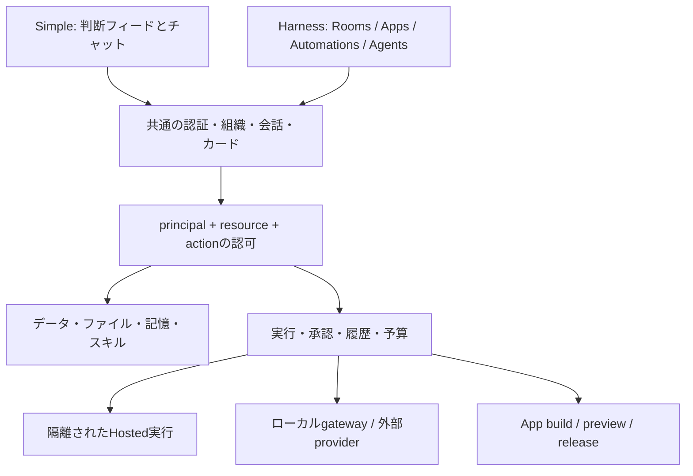

# Simpleを保つ拡張設計

## 不変条件

- 既存の判断カード・フィード・チャット・Routines・Playbookと既存クライアントを維持する。
- 新規・既存workspaceの既定はSimple。既存APIとschemaを破壊しない。
- modeは表示。データ保持・アクセス権・監査・保存済みルームルールはmodeで無効にしない。
- Harnessのコードは追加モジュール・遅延ロード。SimpleにApp builder/gatewayの必須起動や課金を持ち込まない。
- 画面を隠すことと、自動化を停止することは別。Simpleに戻しても保存済み自動化は既存スケジュールで動く。停止は自動化の操作として明示する。

## 体験を二層に分ける

`org_settings.mode` はチームの既定表示。Web/Electronの `hx.simple.<base>.<org>` はそのブラウザだけのSimple優先設定。後者は非adminでも利用でき、共有modeのPUTを呼ばない。現在の設定はブラウザprofile単位で同じ端末の利用者に共通。ユーザーごとの端末間同期には別途authenticated preference APIを追加する。

効果的な表示は `browserSimple ? simple : workspaceMode`。workspace・sessionが変わると古いmodeとcanEditを破棄し、応答前はSimple。機能の権限チェックは常にサーバーで行う。

## 分離する責務

| 境界 | 実装方向 |
|---|---|
| Identity/Policy | 人・agent・app・workflowをprincipalとして扱い、依頼者と代理実行者を別々に検証。workspace adminのprivate room bypassは禁止 |
| Resources | 所有room、追加参照、共有grantを分離。リンクは権限付与ではない。既存Appの共有範囲を勝手に縮小せず移行プレビューを作る |
| Runs | durable run、revision、step、effect receipt、lease、cancel token。決定カードはapprovalの一つのUI |
| Memory | structured entryとsource room/person、共有knowledge、TTL/review。現在の記憶は互換readerで読み、適用先不明を全社共有に変換しない |
| App runtime | 既存typed tablesを互換adapterで使い続ける。Database Appのcontract、次にCustom Appのisolated build/preview DB/hostを追加 |
| Integrations | secret vaultと許可host、接続owner、agent/app grant。検索カタログと実行権を分離 |
| Metering | 事前予約→実行→精算。既存Simple個人プランとHarness workspace creditsを分離して移行 |
| Clients | Web/Electron先行、SwiftUI/Expoは既存APIに追加対応。全端末の機能表を持ち、Web実装だけで全対応としない |

## 実装順と依存関係

### A. データ・認可・Simple回帰

今回のmode/grant/guidelines修正を基点に、App/Table/Workflow/Follow-upのroom ACLを統一する。新しい `resource_grants`、`agent_memberships`、`resource_threads` を追加し、既存の公開範囲を明示する移行を設計する。旧clientでSimpleが動くことをリリース条件にする。

### B. 会話・記憶・実行

固定thread、single leader/handoff、run cancel、structured memoryを実装。外部作用のretry/idempotencyとimmutable workflow revisionを先に整える。既存workflowが承認待ちの間に編集された場合も開始時の定義を使う。

### C. Database Apps

entity/relation、calendar、保存ビュー、record discussion、OpenAPI contract、bulk import/export、App内automation。既存Tableは壊さず互換APIを維持する。移行前後の件数・型・ID・関連・会話リンクを検証してから切替。

### D. Custom Apps

隔離build、Git draft、preview DB fork、migration journal、commitに束縛した公開承認、hosting、rollback、domain、App connection proxy。実行基盤の選定と資格情報の接続が必要。ボタンだけ実装して公開済み扱いにしない。

### E. Gateway・スキル・接続

ローカルdaemon、device link、provider adapters、ACP、offline/reconnect、skill packages、接続catalog・OAuth・MCP・custom APIs。外部providerごとの契約・キー・試験accountが必要。既存契約の認証方式は公式条件を確認する。

### F. 予算・配布・同等性試験

workspace credits、budget policy、通知、各native client、音声/生成media。全93項目の受入証拠を揃え、差異と環境限定機能を明示した互換版としてリリース。その後に判断フィードを用いた比較実験へ進む。

## このブランチの運用

DB追加は `hx_room_guidelines`、`hx_memory_scopes`、`hx_workflow_run_definitions`、`hx_app_access`。schema/migrationは冪等なCREATE。既存データのDELETEや破壊的ALTERはない。新テーブルを適用後にWorkerを更新し、その後Webを配布する。旧Workerへ戻しても新テーブルは残してよい。新UIには新APIが必要。

未完了: Agent admin/memberの完全なモデル、旧記憶の出典復元・人単位の記憶共有、App等のACL、BYOへのguidelines、全AI入口、nativeの個別Simple設定。テスト合格はこれらの完了を意味しない。

## 2026-10-16の追加実装

新規チャット記憶には、元の会話キーとcontext/preference/feedback/referenceの型を別テーブルに保存する。既存記憶の自動移動は行わない。スコープ行がない旧記憶と明示共有知識は従来どおり共有されるため、旧記憶に私的内容がある場合のレビュー・移行は別途必要。会話を指定する新APIは会話認可を先に行う。保存済みDMキーは依頼者の表示用参照へ解決してから認可する。

run開始時に定義スナップショットを原子的に保存。再開時は保存定義を使うが、実行権限は現在の状態で再検証する。新テーブルが存在しない旧Workerへ戻すと旧動作に戻り、分離保証を失うため、この変更後のロールバック先にも認可修正が必要。

## Database Appの公開範囲

`hx_app_access` は後方互換のsidecar。行のない既存Appは従来のworkspace共有を保持し、所有者だけがprivate/workspaceをversion付きで変更できる。privateは現在のworkspace membershipを持つ所有者のみで、管理者の迂回はない。ルームリンク自体は権限を付与しない。

同じAppのtableへのHTTP/MCPアクセス、Home集計、Workflow定義・run履歴・実行時の書き込み・row triggerにもポリシーを適用。過去に別の場所へ送信済みのメッセージや承認カードの複製を遡って消す機能ではない。所有者移譲・明示的な個人/room grants・匿名公開・Custom App hostingは別の未完了項目。

## レコード契約の互換境界

`/tables/:id/contract` は現在のテーブル定義からOpenAPI 3.1を生成する。`validation: "strict"` を選ぶ書き込みだけに、同じ定義に基づく型・列ID・形式の検証を適用する。既存のSimple/agent/workflowクライアントの値変換を突然変更しない。契約は現時点のスナップショットで、スキーマ変更との競合や契約バージョンの固定は今後の課題。

行の更新・削除はDBで `updated_at` の一致を条件に実行する。新Webは読み取った `updatedAt` を `expectedUpdatedAt` として送り、MCPも同じ引数を受け付ける。時刻は更新ごとに最低1ms進めるため、同一ミリ秒の連続更新でもトークンを再利用しない。409の操作では後続ワークフローを発火しない。古いクライアントがトークンを送らない場合もサーバー内の読取/更新間の競合は検知するが、ユーザーが古い画面を見ていたかは判定できない。
